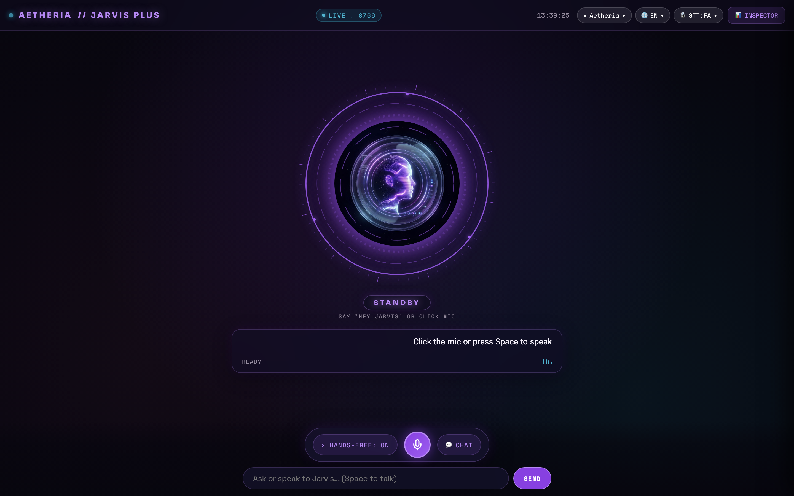
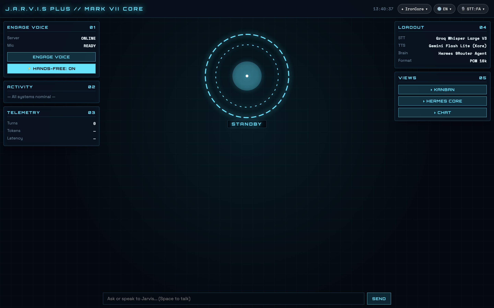
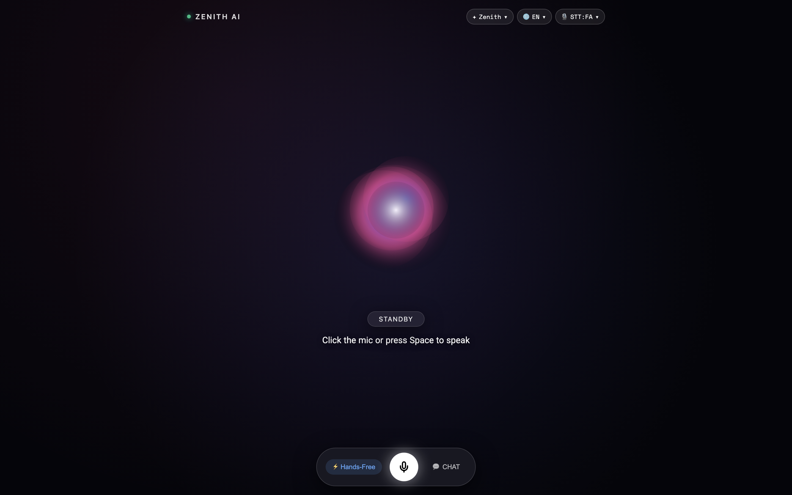
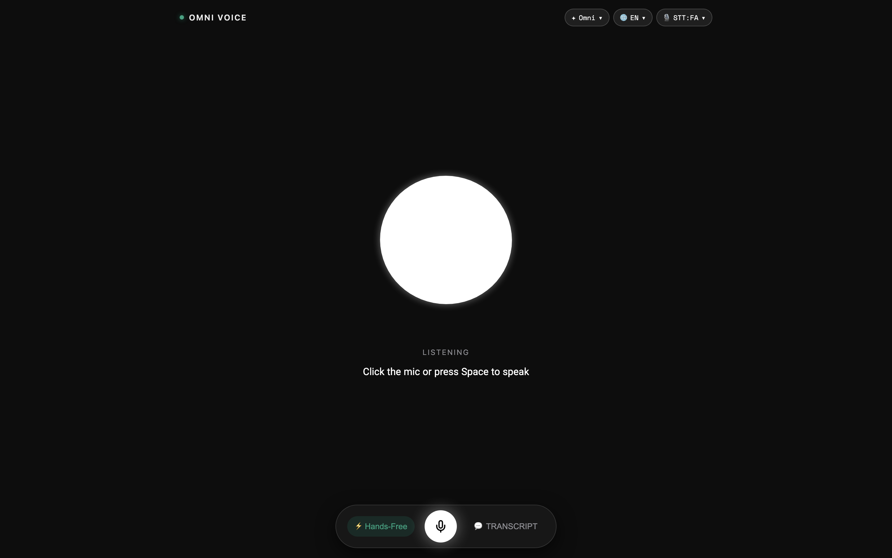
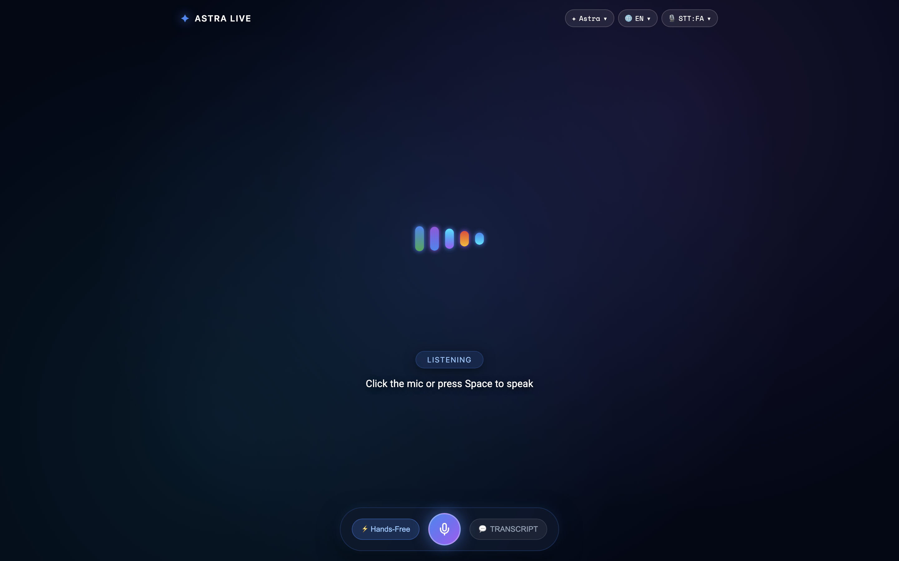
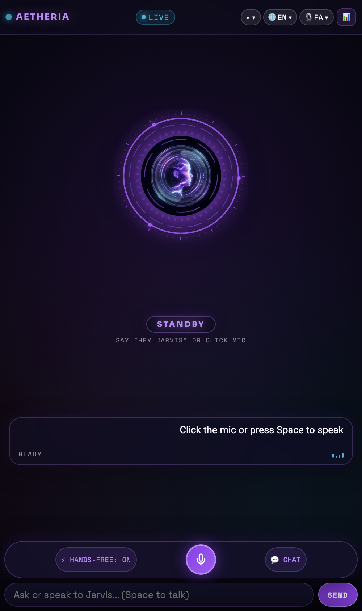

# J.A.R.V.I.S Plus — Holographic HUD Interfaces Guide

J.A.R.V.I.S Plus includes **5 built-in holographic interface templates**, allowing users to tailor their command center aesthetic to their personal preference.

All templates share the unified voice core ([`server/hud/core.js`](../server/hud/core.js)) and internationalization engine ([`server/hud/i18n.js`](../server/hud/i18n.js)), meaning voice state, conversation memory, and microphone controls remain seamless when switching between styles.

---

## The 5 Available Themes

### 1. ✦ Aetheria (Default / Futuristic Female AI)


- **Aesthetic**: Clean holographic purple/cyan sci-fi assistant inspired by Cortana and F.R.I.D.A.Y.
- **Centerpiece**: Glowing female holographic silhouette with dual concentric orbital sound rings, soundwave aurora halos, and a floating translucent glass subtitle card.
- **Key Features**:
  - Top bar featuring quick STT language switcher, UI language picker, and template switcher.
  - Slide-over System Inspector for audio calibration and real-time CPU/memory diagnostics.
  - Floating glass dock with Hands-Free (VOX), Push-to-Talk (PTT), and System controls.
- **URL Parameter**: `?template=aetheria`

---

### 2. ⚙️ IronCore (Tactical Arc Reactor Mark VII)


- **Aesthetic**: Stark Industries military-grade tactical sci-fi HUD.
- **Centerpiece**: The iconic Tony Stark Mark VII Arc Reactor core featuring rotating segmented mechanical rings, pulsing blue/cyan photon emitters, and acoustic energy spikes.
- **Key Features**:
  - High-density sci-fi data grid with live telemetry panels.
  - High-contrast HUD designed for dark workspaces and multi-monitor battle stations.
- **URL Parameter**: `?template=ironcore`

---

### 3. 🔮 Zenith (Apple Siri & Intelligence Morph)


- **Aesthetic**: Minimalist fluid orb inspired by Apple Intelligence and Siri.
- **Centerpiece**: Real-time WebGL/Canvas iridescent color orb that smoothly morphs its boundary curves and color spectrum in response to human speech harmonics.
- **Key Features**:
  - Focus-mode interface with zero distraction.
  - Smooth pill badges for state transitions (Standby, Listening, Processing, Speaking).
- **URL Parameter**: `?template=zenith`

---

### 4. 💬 Omni (ChatGPT Advanced Voice Mode)


- **Aesthetic**: Minimalist matte black studio aesthetic inspired by ChatGPT Voice Mode.
- **Centerpiece**: Soft, deformable organic white/blue sound blob.
- **Key Features**:
  - Ultra-low visual fatigue for long voice sessions.
  - Clean floating pill dock.
- **URL Parameter**: `?template=omni`

---

### 5. ✨ Astra (Google Gemini Live Neural Waves)


- **Aesthetic**: Cosmic deep navy canvas with starlight particles and glowing aurora gradients.
- **Centerpiece**: Multi-bar neural frequency spectrum that bounces and glimmers dynamically with audio amplitude.
- **Key Features**:
  - Shimmering starlight effects and multi-hue gradient waveforms (`#4285f4`, `#9b51e0`, `#00e5ff`).
  - High-fidelity visualizer for users who enjoy seeing audio frequency bands.
- **URL Parameter**: `?template=astra`

---

## 📱 Mobile Experience (iOS & Android)


All 5 templates automatically adapt to mobile devices:
- **100dvh Viewport Support**: Prevents mobile browser navigation bars (Safari bottom bar, Chrome address bar) from clipping buttons.
- **Auto-Scaling Centerpiece**: The reactor/orb shrinks proportionately so transcripts have maximum screen real estate.
- **Touch-Friendly Controls**: Large tap targets for Hands-Free, Push-to-Talk, and System toggles.

---

## URL Parameters & Deep Linking

You can launch directly into any template and language using URL query parameters:

| Parameter | Values | Example |
| :--- | :--- | :--- |
| `template` | `aetheria`, `ironcore`, `zenith`, `omni`, `astra` | `?template=ironcore` |
| `lang` | `en`, `fa`, `ar`, `es`, `fr`, `de`, `zh`, `ru`, `ja` | `?lang=fa` |
| `token` | Any security token string | `?token=jarvis-plus-token` |

**Full Example**:
```
https://192.168.1.100:8766/hud/?token=my-token&template=aetheria&lang=en
```

---

## How to Create a Custom Template

Each template is completely modular and located in `server/hud/templates/<template_name>/`:
1. Create a folder: `server/hud/templates/mytheme/`
2. Add `mytheme.css` and `mytheme.js`.
3. In `mytheme.js`, implement the template lifecycle contract:
   ```javascript
   const MyTheme = {
     id: "mytheme",
     name: "My Custom Theme",
     mount(container) {
       container.innerHTML = `<div id="my-theme-stage">...</div>`;
       // Attach event listeners and canvas animations
     },
     destroy() {
       // Cancel animation frames and clean up listeners
     }
   };
   window.JarvisTemplates.register(MyTheme);
   ```
4. Include stylesheet in `server/hud/index.html`.
